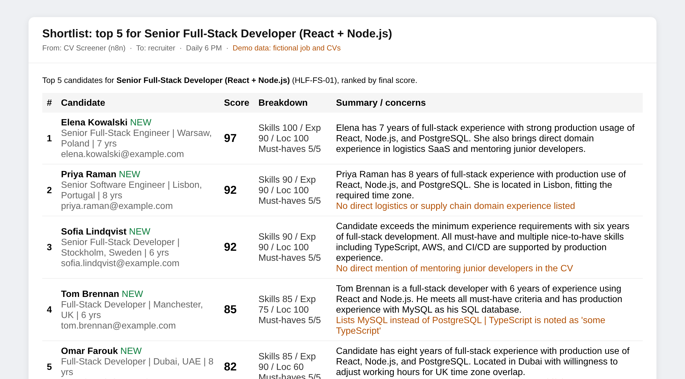
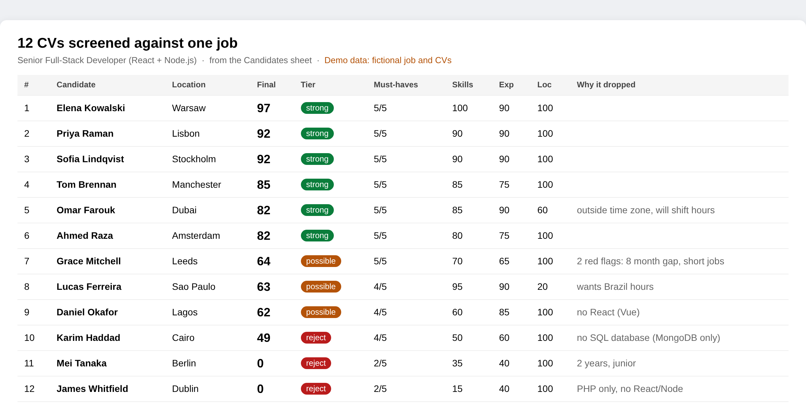
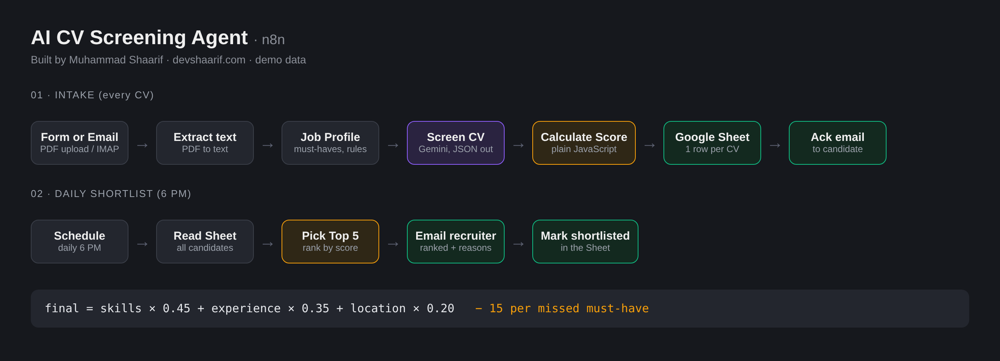

# AI CV Screening Agent (n8n)

An n8n system that reads every CV that comes in, scores it against the job description and emails the recruiter a ranked top 5.



## The problem

A single remote job post can get 200+ CVs. Someone has to open each one, check it against the must-haves, keep notes in a sheet and reply to every candidate. The good CVs get found late, and most candidates never hear back.

## What it does

1. **CV comes in** through an n8n form (PDF upload) or by email (PDF attachment, subject contains "Application").
2. **Extracts the CV text** from the PDF.
3. **AI screens the CV** with Gemini against the job: checks each must-have with evidence, lists matched and missing skills, and gives skills, experience and location sub scores.
4. **Code calculates the final score**, not the AI (see Scoring below).
5. **Logs everything to Google Sheets**, one row per candidate.
6. **Sends the candidate an acknowledgement email** (optional, no score in it).
7. **Every day at 6 PM** a second workflow emails the recruiter the top 5, ranked, with the reasons.

## Demo

Demo run on my own n8n with 12 fictional CVs for a fictional job (Senior Full-Stack Developer, React + Node.js, UK hours).

| | |
|---|---|
| CVs screened | 12 of 12, no errors |
| Time per CV | about 6 to 7 seconds (form to Sheet row) |
| Strong / possible / reject | 6 / 3 / 3 |
| Top score | 97 / 100 (7 years, logistics SaaS, all 5 must-haves) |



What the scoring caught:
- **Lucas** had one of the best skill scores (95) but wants Brazil hours. Location 20 and a missed must-have dropped him to 63.
- **Omar** is outside the time zone but said he will work UK hours. Location 60, still in the top 5.
- **Karim** is a solid MERN developer but has no SQL database. One missed must-have, 49, reject.
- **Grace** meets every must-have, but an 8 month gap and many short jobs (2 red flags) cost her 10 points.
- **Omar and Ahmed tied at 82.** The shortlist shows 5, so a person should look at #6 too.

Acknowledgement emails in the demo went to my own inbox. All other demo addresses use `example.com`, which the workflow never emails.

## Workflows

| File | What it does |
|---|---|
| `workflows/00-setup-candidates-tab.json` | Run once. Creates the `Candidates` tab in your Google Sheet |
| `workflows/01-cv-intake.json` | Form or IMAP, PDF text, AI screening, score, Sheet, acknowledgement |
| `workflows/02-daily-shortlist.json` | Daily at 6 PM (or run manually). Top 5 email to the recruiter |



## Scoring

The AI returns three sub scores from 0 to 100 and a met / not met for each must-have. The final score is plain JavaScript in the `Calculate Score` node:

```
final_score = skills × 0.45 + experience × 0.35 + location × 0.20
-15 for each must-have not met
-10 if below the minimum years
-10 if 2 or more red flags

strong    >= 75 and every must-have met
possible  55 to 74
reject    < 55
```

Why: the same CV always gets the same score from the same sub scores, you can change the weights without touching the prompt, and you can show a hiring manager exactly why someone ranked where they did.

The prompt tells the model to ignore age, gender, nationality, name, photo and university prestige. Location only counts through the job's time zone rule.

Prompts are in [`prompts/`](prompts) and the output schema is in [`schema/screening-output.schema.json`](schema/screening-output.schema.json).

## Stack

- n8n (self-hosted, Docker)
- Google Gemini (`gemini-flash-lite-latest`) via the n8n Gemini Chat Model node
- n8n Extract From File (PDF text)
- Google Sheets (service account)
- SMTP for sending, IMAP for email applications

## Setup

1. **Google Sheet**: create a sheet and share it with your Google service account email (Editor).
2. **Import** the 3 JSON files in n8n: Workflows > Add workflow > `...` > Import from File.
3. **Credentials** (create in n8n, then select on each red node):
   - Google Service Account (Sheets nodes)
   - Google Gemini (PaLM) API (Gemini Chat Model). Free key from Google AI Studio.
   - SMTP (Send Acknowledgement, Email Shortlist)
   - IMAP (Email Applications). Optional. Delete the node if you only want the form.
4. **Replace placeholders**:
   - `YOUR_SHEET_ID` in every Google Sheets node
   - `you@yourdomain.com` and `Your Name` in the email nodes and in `Shortlist Settings`
   - Your job in the `Job Profile` node: title, company, summary, must-haves (one per line), nice-to-haves, minimum years, location rule
   - `job_id` must match in `Job Profile` and `Shortlist Settings`
   - In the IMAP node, set the `SINCE` date to the day you start
5. Run `00 Setup` once. The header row is written by the first CV.
6. Test: open `01`, click `Execute workflow`, open the form and upload a PDF CV. Sample fictional CVs are in [`demo/cvs/`](demo/cvs).
7. Run `02` with `Run Now (demo)` to get the shortlist email.
8. Publish `01` and `02`.

Set `send_ack` to `false` in `Job Profile` to turn off candidate emails. Addresses on `example.com` never get an email (demo safety).

## Limits

- PDF only. Scanned PDFs with no text layer are logged as `needs_review` instead of being scored.
- AI scores are a first pass to sort the pile. A person reads the CVs and makes the decision. Do not auto-reject on the score alone.
- The model can misread dates or miss a skill written in an unusual way. Each must-have comes with an evidence quote so you can check it fast.
- Gemini free tier can return 503 "high demand". The AI node retries 4 times, 5 seconds apart.
- One job per workflow copy. For more jobs, duplicate the workflow and change `Job Profile`.
- If you handle real candidate data, check your local data protection rules (for example GDPR) and tell candidates how their CV is processed.

## Sheet columns

See [`sheet/columns.tsv`](sheet/columns.tsv). Status values: `screened`, `needs_review`, `shortlisted`.

## Demo data

The job (Harbourline Freight) and all 12 CVs are fictional, made for this demo. No real candidates, no client data.

## Author

Built by **Muhammad Shaarif**, developer building AI-assisted software for real businesses.
[devshaarif.com](https://devshaarif.com)

## License

MIT
